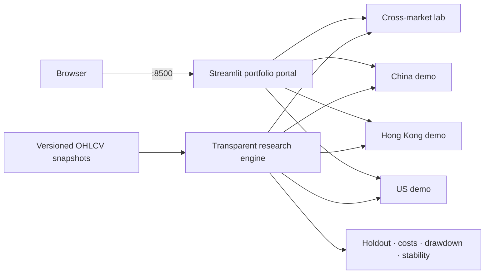

# Tri-market quantitative research platform

An inspectable equity-research system for China A-shares, Hong Kong equities and US equities. The public portfolio runs offline from versioned snapshots; the full local workspace adds provider fallbacks, venue-aware backtests, scanners, risk controls and paper-execution adapters.

> Educational research software, not investment advice. Backtests are hypothesis evidence, not permission to trade.

## What this demonstrates

| Area | Evidence in the repository |
|---|---|
| Quant research | Explainable signals, one-bar lag, chronological 70/30 holdout and train/validation comparison |
| Cross-market research | The same rule across nine snapshots, venue/default cost comparison and instrument-level scorecards without pooled-return claims |
| Robustness | Transaction-cost sensitivity, drawdown paths and parameter-neighborhood stability |
| Market engineering | Symbol normalization, quote freshness, provider fallbacks and venue-specific fee/lot rules |
| Production judgment | Bounded caches, process isolation, health checks, CI and deterministic demo fixtures |
| Safety | Read-only public mode, paper-first execution, broker/live-port boundaries and current-price trade gates |

The full local services contain seven strategy families. The compact public demo deliberately uses four transparent long-only rules so every assumption can be inspected quickly.

## 30-second demo path

1. Open **Cross-market lab** and apply one research rule to all nine versioned instruments.
2. Change the cost basis or market filter and inspect how the evidence changes without pooling currencies or calendars.
3. Read the risk-return map, excess-return ranking and train/validation transfer view.
4. Open **Scorecard** to compare the complete instrument-level table or download it as CSV.
5. Drill into one market, then open **Data and assumptions** to inspect provenance and download its deterministic return-path CSV and JSON evidence bundle.

The interface does not select the most flattering run or promise profitability. It labels evidence as consistent, mixed or weak within the chosen snapshot.

## Architecture



Public deployment is one Streamlit process and one exposed port. The full local launcher keeps the three original market applications in separate processes because their import roots, sessions, provider state, venue rules and broker state must not leak across markets.

See [docs/ARCHITECTURE.md](docs/ARCHITECTURE.md) for both runtime topologies and [docs/PORTFOLIO_WALKTHROUGH.md](docs/PORTFOLIO_WALKTHROUGH.md) for an interview-ready walkthrough.

## Quick start

Python 3.11 or 3.12 and [uv](https://docs.astral.sh/uv/) are recommended.

### Public portfolio — one process, offline data

```bash
uv sync --extra dev
./run_public.sh
```

Open [http://localhost:8500](http://localhost:8500). No broker, API key or live quote service is required.

Validate fixture integrity and public-release boundaries at any time:

```bash
python scripts/release_check.py
```

### Full local workspace — four isolated processes

```bash
uv sync --extra dev
./run_all.sh
```

The portal uses port 8500; the US, Hong Kong and China services use 8501, 8502 and 8503. One `Control-C` stops processes owned by the launcher. A single market can also be started with `./run_us.sh`, `./run_hk.sh` or `./run_cn.sh`.

Optional Futu OpenD support is installed with `uv sync --extra dev --extra brokers`. The IBKR TWS Python API is distributed separately; see [IBKR_SETUP.md](IBKR_SETUP.md).

## Research contract

```text
timestamped data -> explainable signal -> one-bar execution lag
                 -> chronological holdout -> costs and venue rules
                 -> robustness checks -> paper monitoring
```

- Historical observations stay in time order; future rows never fit earlier decisions.
- Fees, slippage, turnover, lot sizes and position limits remain visible.
- Parameter scans show the full neighborhood instead of retaining only the best value.
- Quote age and provider failures are surfaced rather than silently labelled live.
- Local decision cards re-check price location, reward/risk, stop distance, cache state and market session before exposing any simulated order size.
- Public mode cannot render local broker controls or child workspaces.

The detailed evidence contract is in [docs/VALIDATION.md](docs/VALIDATION.md).

Release history is tracked in [CHANGELOG.md](CHANGELOG.md). Before publishing, use the [public release checklist](docs/PUBLIC_RELEASE_CHECKLIST.md) and [GitHub publishing guide](docs/GITHUB_PUBLISHING.md); contribution and disclosure guidance live in [CONTRIBUTING.md](CONTRIBUTING.md) and [SECURITY.md](SECURITY.md).

## Tests and CI

```bash
./test_all.sh
```

The current suite contains **191 standard tests plus 19 generated subtests** across the public portfolio, the A-share strategy lab and three isolated market services. It covers accounting realism, look-ahead protection, T+1 execution, robustness grids, market clocks, data-source switching, scanners, watchlists, venue constraints, broker safety, public-boundary behavior and Streamlit page rendering. GitHub Actions runs every suite independently.

## Docker

```bash
docker compose up --build
```

Docker starts the read-only public portfolio and exposes only port 8500. The three local market services and broker controls are neither started nor exposed.

## Repository layout

```text
.
├── streamlit_app.py          # single-entry portfolio portal
├── app_pages/                # overview, cross-market lab, market demos and methodology
├── portfolio/                # deterministic demo engine, UI and tests
├── demo_data/                # compact versioned public snapshots
├── systems/
│   ├── cn/                   # China A-share research service
│   ├── cn_lab/               # short-horizon A-share strategy and backtest lab
│   ├── hk/                   # Hong Kong research service
│   └── us/                   # US research and paper-execution service
├── scripts/                  # fixture, launcher and test orchestration
├── docs/                     # architecture, validation and walkthrough
├── pyproject.toml            # reproducible dependencies
└── Dockerfile
```

## Known limitations

- Public-provider history is not a point-in-time, survivorship-free institutional dataset.
- Daily and snapshot research cannot model queue priority or tick-level market impact.
- Several strategies share technical inputs; strategy count is not proof of diversification.
- Scheduled scanners depend on their local Streamlit service; production scheduling needs a durable worker.
- Broker connectivity is environment-dependent and intentionally excluded from public CI.
